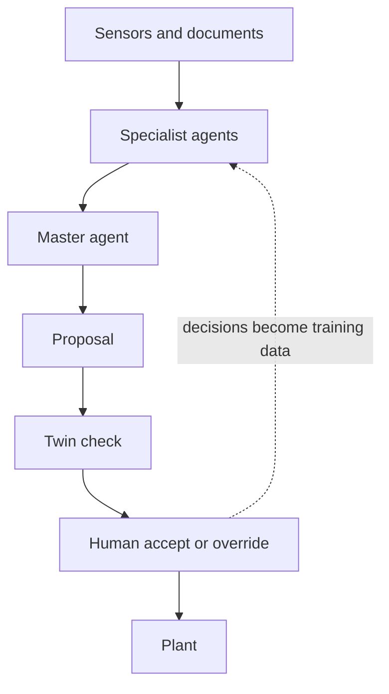

## Why this course

AI is strong at two things: retrieving information from a very large corpus, and reading it to find context. It is weak at causal reasoning from small data, and it can be confidently wrong. For process work, where data are scarce and mistakes are expensive, that combination demands design, not trust.

We once stored information. Then we stored data. Now we can store reasoning, in agents that read, plan, call tools and act. But a plant is not a chat window. Every proposal an agent makes is grounded in SOPs and data, then checked on a digital twin against first principles before a person sees it. The instructor has built and deployed decision systems in production, and the course teaches the patterns that survive contact with operations.

An agent may propose. Physics checks. A human decides.

## Who it is for

#### Graduate students

Build a research-grade agentic system on a process problem of your own, with evaluation you can defend.

#### Researchers

Learn the architecture behind verified agents for self-driving laboratories and automated experimentation.

#### Practicing engineers

Turn SOPs, batch records and deviation reports into an assistant that cites its sources and shows its work.

#### Technical leaders

Learn enough to scope a pilot, ask vendors the right questions, and audit what an agent is allowed to do.

## What you will be able to do

1. **Explain what makes an agent.** Describe goal, tools, memory and loop, and name the failure modes in operations.
2. **Ground agents in process knowledge.** Retrieve from SOPs, P&IDs and batch records, with citations for every claim.
3. **Give agents tools.** Connect simulators, databases and lab systems through function calls and the Model Context Protocol.
4. **Orchestrate a hierarchy.** Coordinate a master agent, specialist agents and a critic that hold up under review.
5. **Verify on a twin.** Apply balance checks and constraint validators so no proposal reaches a human unchecked.
6. **Evaluate, govern and deploy.** Measure agents with traces and benchmarks, keep a human in the loop, and ship a service.

## The architecture you will build

Every week adds one layer to a single system, from the documents and sensors at the bottom to the human sign-off at the top.

The twin is the gate: a proposal that breaks a mass balance or a constraint is sent back before it costs anyone's attention. Each accept or override is logged, so expert judgment becomes data the agents learn from.

## Seven weeks, four moves

The course moves from Play to Build to Verify to Deploy, so you watch an agent work before you build one, and you prove it safe before you ship it.

{{week_grid}}

## Where agents help, and where they do not

| Strong at | Weak at |
|---|---|
| Retrieving the right paragraph from thousands of SOPs and batch records | Causal reasoning from small, noisy process data |
| Summarizing deviation reports and finding context across documents | Knowing when they are wrong; errors arrive with full confidence |
| Drafting structured plans, checklists and investigation reports | Respecting mass and energy balances without being forced to |
| Calling tools such as calculators and simulators in sequence | Staying inside operating limits unless a validator enforces them |

## The capstone

A multi-agent operations assistant that diagnoses a process deviation, grounds every claim in documents and data, verifies its proposed action on a twin, and routes it to a human for sign-off, with a full audit trail.

- A working agent hierarchy that runs end to end on the simulated plant and document corpus
- A twin-in-the-loop verification layer with documented guardrails and failure cases
- A technical memo with evaluation results, an audit trail and a deployment plan

## How every week runs

#### Concept

One hour on the idea of the week, framed as an engineering problem with a plant example.

#### Studio

One hour of guided building: you and your AI assistant work through a design together, live.

#### Lab

One hour of hands-on work in a browser notebook, ending in a working piece of the system.

## What you need, and what you don't

#### You need

A laptop, a web browser, a free AI assistant account, and a process problem you care about.

#### You don't need

Prior coding, a command line, Git, installations, or access to a real plant. A simulated plant and a document corpus are provided.

## Tools you will meet

Claude
ChatGPT
Gemini
Copilot
Cursor
Google Colab
Python
Model Context Protocol
Vector search
Knowledge graphs
Process simulators
Docker
GitHub

## After this course

- Lead an agentic-AI pilot in operations, R&D or tech transfer.
- Specify and audit vendor AI agents against a clear standard of evidence.
- Start research on verified agents for self-driving laboratories.
- Bring a documented, evaluated prototype to your team or committee.

Continue with [Course 2: Digital Twins for Process Engineering]({{root}}digital-twins/index.html) or revisit [Course 1: Reinforcement Learning for Chemical Engineers]({{root}}rl-vibe-coding/index.html).
