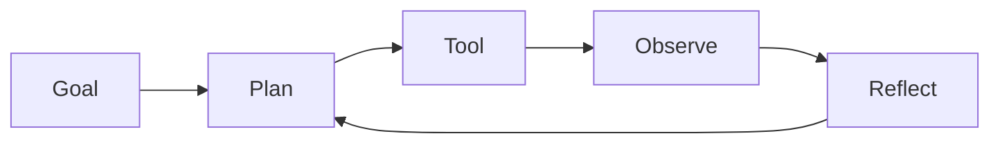

This week separates a chatbot from an agent. You watch an agent troubleshoot a simulated plant upset, then learn to instruct one precisely. For an engineer, the skill that matters is specification: an agent does what its goal, tools and context allow, no more and no less.

## Learning goals

- Define an agent by its four parts: goal, tools, memory and loop.
- Read an agent trace and spot where its reasoning went wrong.
- Write prompts with roles, context and structured outputs, the way you would write a work instruction.
- Name the common failure modes of agents in operations.



## Sessions

<div class="session" markdown="1">

### Session 1 · Concept — What makes an agent: goal, tools, memory, loop

A language model answers; an agent pursues a goal across many steps. We build the idea up from a single prompt to a loop that plans, acts and checks its own work.

**In class**

- Chatbot versus agent, using a pump cavitation question as the running example
- The plan, act, observe, reflect loop and where it stalls
- Short-term context, long-term memory and why both are limited

**Hands-on:** Sketch the goal, tools and memory of an agent for a fermentation upset.

**You leave with:** A one-page agent specification you can critique.

</div>

<div class="session" markdown="1">

### Session 2 · Studio — Play: watch an agent troubleshoot a plant upset

We run an agent on a simulated plant with a developing upset and read its trace together. Some steps are sound, some are confidently wrong, and finding the difference is the exercise.

**In class**

- Live run of an agent diagnosing a reactor temperature excursion
- Annotating the trace: which claims were grounded, which were guesses
- Changing one instruction and watching the behavior change

**Hands-on:** Re-run the agent with a tighter goal and compare traces.

**You leave with:** An annotated trace and a list of observed failure modes.

</div>

<div class="session" markdown="1">

### Session 3 · Lab — Prompting as engineering: roles, context, structured outputs

Prompts are specifications. You write one with a defined role, supplied context and a structured output that downstream software can check.

**In class**

- Roles, constraints and context as the parts of a good prompt
- Structured outputs: asking for a fixed table or JSON instead of prose
- Testing a prompt on three cases, including an adversarial one

**Hands-on:** Build and test a structured-output prompt for classifying deviation reports.

**You leave with:** A tested prompt template and three recorded test cases.

</div>

## Prompt of the week

```text
You are a process troubleshooting assistant for a fed-batch fermentation.
Goal: find the most likely cause of a dissolved oxygen drop at hour 18.
Context: DO fell from 40 percent to 12 percent in 20 minutes while the
agitation setpoint and airflow were unchanged. Feed rate rose 15 percent.
Rules: list at most three hypotheses, rank them, and for each name one
measurement that would confirm or rule it out. Do not recommend a setpoint
change. If the data are insufficient, say so.
Output: a table with columns hypothesis, evidence for, evidence against,
confirming measurement.
```

## Deliverable

<div class="callout tip" markdown="1">

Submit an annotated agent trace from the simulated upset and one structured-output prompt with three test cases, including a note on where it failed.

</div>
