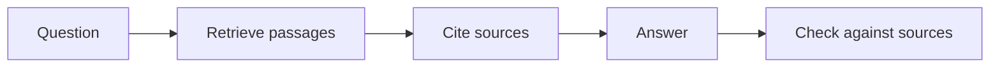

This week grounds agents in what your plant already knows. You build retrieval over SOPs, P&IDs and batch records, then organize process data with an ontology so an agent can follow relationships, not just match words. For an engineer, the result is an assistant whose every answer points back to a controlled document.

## Learning goals

- Explain how retrieval-augmented generation finds and cites relevant passages.
- Decide how to split and index SOPs, batch records and equipment lists.
- Model equipment, streams and procedures as a small knowledge graph.
- Test an assistant for unsupported claims and missing citations.



## Sessions

<div class="session" markdown="1">

### Session 1 · Concept — Retrieval-augmented generation over SOPs and batch records

A model does not know your plant. Retrieval fetches the relevant passages at question time, so the answer is built from your documents and can be traced back to them.

**In class**

- Chunking, embeddings and vector search, explained with an SOP example
- Why retrieval fails: stale revisions, tables, and near-duplicate procedures
- Citations as a control, not a courtesy

**Hands-on:** Index three SOP excerpts and ask five questions of increasing difficulty.

**You leave with:** A working retrieval pipeline and a list of the questions it got wrong.

</div>

<div class="session" markdown="1">

### Session 2 · Studio — Ontologies and knowledge graphs for process data

Documents are text; a plant is a structure. We model equipment, streams, instruments and procedures as nodes and relations, so an agent can answer questions that span documents.

**In class**

- Designing an ontology: what are the entities, what are the relations
- From a P&ID to a graph: vessels, lines, valves and sensors
- Combining graph lookup with document retrieval

**Hands-on:** Build a ten-node graph of a bioreactor train with your assistant.

**You leave with:** A small process ontology and a graph you can query in plain English.

</div>

<div class="session" markdown="1">

### Session 3 · Lab — A process knowledge assistant that cites its sources

You assemble retrieval and the graph into one assistant, then try to break it. The test is whether it refuses when the documents do not support an answer.

**In class**

- Wiring retrieval and graph lookup into a single assistant
- Requiring a citation for every factual sentence
- Red-teaming with questions the corpus cannot answer

**Hands-on:** Run a twelve-question test set and score answers as supported or unsupported.

**You leave with:** A knowledge assistant and a scored test set.

</div>

## Prompt of the week

```text
You are a documentation assistant for a downstream purification suite.
Answer only from the retrieved SOP and batch record passages provided.
For every sentence, add a citation in the form [document, section].
If the passages do not contain the answer, reply "Not supported by the
documents" and name what document would be needed.
Question: What is the hold time limit for the post-Protein A pool, and
what must be recorded if it is exceeded?
Output: a short answer, followed by a list of the citations used.
```

## Deliverable

<div class="callout tip" markdown="1">

Submit your knowledge assistant with a scored twelve-question test set, reporting how many answers were fully cited and how many were correctly refused.

</div>
