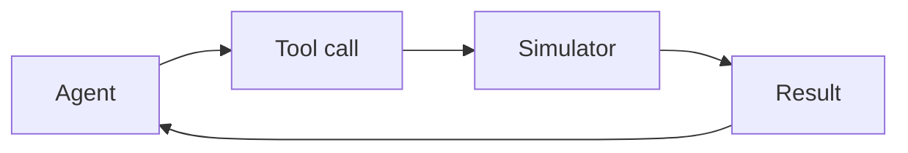

This week gives agents hands. A language model that can call a calculator, a simulator or a database stops guessing numbers and starts computing them. For an engineer, tools are where an agent becomes useful, and also where it becomes dangerous, so we treat every tool as an interface with a contract.

## Learning goals

- Describe how function calling lets a model request a tool and read the result.
- Write a tool definition with typed inputs, units and allowed ranges.
- Explain what the Model Context Protocol standardizes and why it matters for plants and labs.
- Separate read-only tools from tools that change something.



## Sessions

<div class="session" markdown="1">

### Session 1 · Concept — Tool use: calculators, simulators, databases

Models are poor at arithmetic and good at deciding what to compute. We give them tools for the calculation and keep the judgment of when to use each one with the model.

**In class**

- How a model requests a tool and how the result returns to its context
- Tool definitions as contracts: names, units, ranges and error messages
- Read-only versus write tools, and why the difference matters

**Hands-on:** Give an assistant a heat-exchanger calculator and test it on three problems.

**You leave with:** A tool definition template with units and range checks.

</div>

<div class="session" markdown="1">

### Session 2 · Studio — The Model Context Protocol: connecting agents to lab and plant systems

Writing a custom connector for every system does not scale. The Model Context Protocol offers a common way to expose data and tools to any compatible agent, which changes how lab and plant integration is scoped.

**In class**

- What a protocol server exposes: tools, resources and prompts
- Mapping a historian, an electronic lab notebook and a simulator to servers
- Permissions, logging and what an agent should never be allowed to do

**Hands-on:** Draft an interface specification for a historian server, read-only first.

**You leave with:** A connector specification for one plant or lab system.

</div>

<div class="session" markdown="1">

### Session 3 · Lab — An agent that runs a simulation and reads the result

You build an agent that sets up a simulated reactor run, executes it, reads the output and explains what happened. The simulator is the authority; the agent reports what it computed.

**In class**

- Wrapping a simple reactor model as a callable tool
- Letting the agent choose inputs inside allowed ranges
- Reading results and reporting units and uncertainty honestly

**Hands-on:** Ask the agent to compare two feed profiles and justify the better one.

**You leave with:** A working agent that runs a simulation and summarizes the result.

</div>

## Prompt of the week

```text
Build me a tool that wraps a simple fed-batch reactor simulator.
Inputs: feed rate in L per hour (allowed range 0.1 to 2.0), feed
concentration in g per L (range 50 to 400), and run time in hours.
Outputs: final biomass, final product titer, and the time series of
dissolved oxygen.
Reject any input outside its range with a clear error message that
states the allowed range. Then write an agent that calls the tool for
two feed rates and reports which gives the higher titer, with units.
```

## Deliverable

<div class="callout tip" markdown="1">

Submit a simulator-calling agent, its tool definition with units and range checks, and a short note on what the agent is not permitted to do.

</div>
