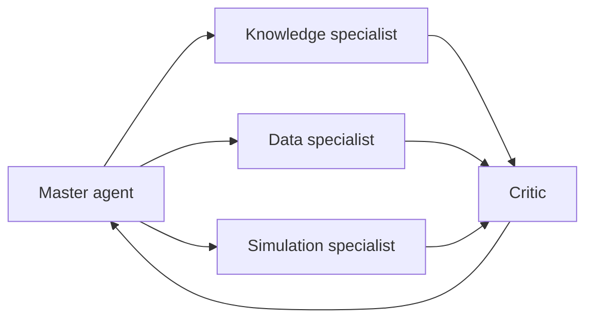

This week organizes agents the way a plant organizes people. A master agent breaks a problem apart, specialists handle knowledge, data and simulation, and a critic challenges the result before it moves on. For an engineer, the hierarchy is a design choice with trade-offs in cost, speed and reliability.

## Learning goals

- Describe the roles of a master agent, specialist agents and a critic.
- Choose between plan-execute, reflection and debate patterns for a given task.
- Define each agent's scope so responsibilities do not overlap.
- Recognize where multi-agent systems add errors rather than remove them.



## Sessions

<div class="session" markdown="1">

### Session 1 · Concept — Hierarchical agents: master, specialists, critic

One agent doing everything gets confused by its own context. We split the work into narrow specialists under a coordinator, with a critic whose only job is to find problems.

**In class**

- Sensor layer, small agents, mid-level reasoning and a master agent
- What each specialist sees, and what it is not allowed to see
- The critic as an independent check, with its own instructions

**Hands-on:** Draw the agent hierarchy for a bioreactor deviation investigation.

**You leave with:** A role card for each agent: scope, tools, inputs and outputs.

</div>

<div class="session" markdown="1">

### Session 2 · Studio — Orchestration patterns: plan-execute, reflection, debate

Different tasks need different control flow. We compare three patterns on the same problem and measure where each one helps and where it only adds cost.

**In class**

- Plan-execute: write the plan first, then follow it step by step
- Reflection: draft, critique, revise, with a stopping rule
- Debate: two agents argue opposing causes before the master decides

**Hands-on:** Run the same deviation case through two patterns and compare outputs.

**You leave with:** A short comparison of quality, cost and run time across patterns.

</div>

<div class="session" markdown="1">

### Session 3 · Lab — A multi-agent troubleshooting team

You assemble a master, three specialists and a critic into one team and run it on a simulated deviation. The goal is a diagnosis that cites documents, uses data and survives the critic.

**In class**

- Implementing the hierarchy with your AI assistant
- Passing structured messages between agents, not free text
- Setting a step limit and a handoff rule when agents disagree

**Hands-on:** Run the team on two deviation cases and read the full trace.

**You leave with:** A working multi-agent team and traces from two cases.

</div>

## Prompt of the week

```text
Design a team of agents to investigate a pH excursion in a cell
culture bioreactor.
Agents: a master that plans and decides, a knowledge agent that
searches SOPs and batch records, a data agent that reads sensor
history, a simulation agent that runs the reactor model, and a critic.
Rules: agents exchange JSON messages with fields claim, evidence and
confidence. The critic must list at least two weaknesses in the
proposed cause. The master stops after six rounds and reports any
unresolved disagreement instead of hiding it.
Write the role instructions for each agent.
```

## Deliverable

<div class="callout tip" markdown="1">

Submit a working multi-agent team with a role card for each agent and traces from two simulated deviations, noting one case where the critic changed the outcome.

</div>
