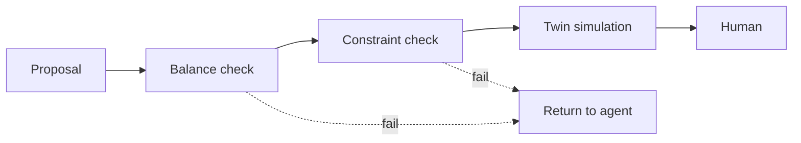

This week is the center of the course. A hallucinated action in an operations setting is an unsafe action, so no proposal is allowed to reach a person until it has passed checks grounded in physics. You build those checks and place a digital twin in the loop.

## Learning goals

- Catalog how agents fail in operations: invented tags, wrong units, violated limits and plausible but impossible moves.
- Write validators for mass balances, energy balances and operating constraints.
- Place a twin between the agent and the human so every proposal is simulated first.
- Decide what happens when a check fails: reject, repair or escalate.



## Sessions

<div class="session" markdown="1">

### Session 1 · Concept — Why agents must be checked: failure modes in operations

Agents fail in ways that look reasonable on the page. We collect real patterns of failure and ask which ones a reader would catch, and which would slip through a busy shift.

**In class**

- Invented sensor tags, mixed-up units and stale setpoints
- Proposals that are individually plausible but violate a balance
- Why asking the model to double-check itself is not a control

**Hands-on:** Review ten agent proposals and mark which are safe, unsafe or unclear.

**You leave with:** A failure-mode catalog for your own process.

</div>

<div class="session" markdown="1">

### Session 2 · Studio — First-principles guardrails: balance checks, constraint validators

Guardrails written as ordinary code do not hallucinate. We write validators that test a proposal against mass and energy balances and the operating envelope, and return an explanation when it fails.

**In class**

- Closing a mass balance on a proposed feed change
- Encoding temperature, pressure, pH and rate limits as constraints
- Failure messages an agent can act on, not just a rejection

**Hands-on:** Write a validator for a feed change and test it on good and bad proposals.

**You leave with:** A reusable guardrail module with unit tests.

</div>

<div class="session" markdown="1">

### Session 3 · Lab — Twin-in-the-loop, so no proposal reaches a human unchecked

You connect the multi-agent team to the validators and a simulator. Each proposal is simulated, scored against limits and either sent back or passed to a person with its evidence attached.

**In class**

- Routing every proposal through checks before it is shown
- Looping failed proposals back to the agent with the violation stated
- Attaching simulated outcomes to the proposal the human sees

**Hands-on:** Feed the system five proposals, two of them deliberately unsafe, and confirm both are stopped.

**You leave with:** A twin-in-the-loop pipeline and a log of every check.

</div>

## Prompt of the week

```text
Write a validator that checks a proposed change to a fed-batch process
before a human sees it.
Proposal fields: new feed rate in L per hour, new temperature setpoint
in degrees C, and a stated reason.
Checks: feed rate between 0.1 and 2.0, temperature between 30 and 38,
total volume at end of run below 10 L, and oxygen demand at the new
feed rate below the oxygen transfer limit of the reactor.
If any check fails, return the failed check, the computed value and the
limit. If all pass, run the simulator and attach the predicted titer.
```

## Deliverable

<div class="callout tip" markdown="1">

Submit a twin-in-the-loop pipeline with a guardrail module, tests, and a log showing that unsafe proposals were stopped before reaching the human step.

</div>
