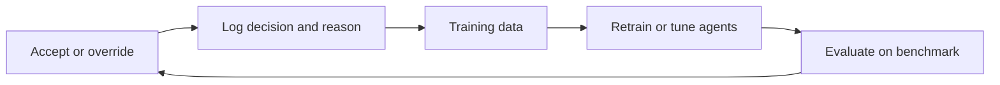

This week closes the loop between agents and the people who run the process. Every accept or override is a labeled example of expert judgment, and a system designed to capture it improves with use. We also set the standard of evidence an agent must meet before anyone relies on it, including GMP and data-integrity expectations.

## Learning goals

- Design an accept or override step that records the decision and the reason.
- Use logged decisions as training and evaluation data for the agents.
- Evaluate an agent with traces, benchmarks and failure analysis, not impressions.
- Map agent behavior onto GMP, data-integrity and audit-trail expectations.



## Sessions

<div class="session" markdown="1">

### Session 1 · Concept — Accept or override: expert decisions as training data

A production decision system earns trust when experts can accept or override its choices and those choices flow back as data. We design the interface and the data model so the signal is clean.

**In class**

- Cloning expert choices into a policy, then measuring where it disagrees
- Capturing reasons for overrides, not only the override itself
- Bias and drift: when logged decisions stop reflecting good practice

**Hands-on:** Design a decision record with fields for proposal, evidence, outcome and reason.

**You leave with:** A decision-log schema and a feedback plan for your capstone.

</div>

<div class="session" markdown="1">

### Session 2 · Studio — Evaluating agents: traces, benchmarks, failure analysis

An agent that looks good in a demo may fail one run in ten. We build a small benchmark of plant cases, score runs automatically and sort failures into causes.

**In class**

- Building a benchmark of deviation cases with known answers
- Scoring correctness, grounding, constraint violations and cost
- Failure analysis: retrieval miss, tool misuse, reasoning error or bad data

**Hands-on:** Score your team from Week 4 on eight cases and tabulate failure types.

**You leave with:** A benchmark, a score table and a ranked list of failure causes.

</div>

<div class="session" markdown="1">

### Session 3 · Lab — Safety, security and compliance: GMP, data integrity, audit trails

Regulated environments ask who did what, when and why. We add an audit trail, access limits and a review step so the system could be explained to an inspector.

**In class**

- Attributable, legible, contemporaneous, original and accurate records for agent actions
- Prompt injection, data leakage and tool permissions as security issues
- Change control for prompts, models and tools

**Hands-on:** Add an audit log and a permission list to your agent team.

**You leave with:** An audit trail and a one-page risk register for your system.

</div>

## Prompt of the week

```text
Add a decision log to my process-operations agent.
Every proposal shown to a human must be stored with: timestamp, case
id, proposed action, the evidence cited, the twin check results, and
the model and prompt version.
Add an accept or override control. If the human overrides, require a
reason chosen from a short list plus a free-text note.
Store everything in a table I can export. Then write a script that
computes the override rate by reason, so I can see where the agent
disagrees with experts most often.
```

## Deliverable

<div class="callout tip" markdown="1">

Submit your benchmark with scores and failure analysis, plus the decision-log schema and audit trail added to your agent team.

</div>
