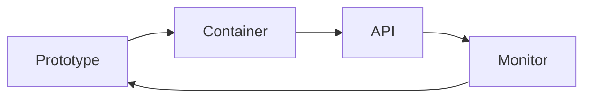

This week turns a notebook prototype into something other people can use. You package the agent as a service, watch its cost and reliability, and look ahead to agents that run experiments in self-driving laboratories. The week ends with capstone showcases and an honest look at the research frontier.

## Learning goals

- Explain how a prototype becomes a service: container, interface and monitoring.
- Estimate the cost, latency and reliability of an agent in routine use.
- Describe how verified agents can run experiments in a self-driving laboratory.
- Present a capstone with evidence, limits and a deployment plan.



## Sessions

<div class="session" markdown="1">

### Session 1 · Concept — From prototype to service: containers, APIs, monitoring

A notebook is not a product. We cover what it takes to run an agent for other people: a container that bundles its environment, an interface others can call, and monitoring that catches drift. This is the one gentle introduction to Git and GitHub.

**In class**

- Containers explained as a batch record for software: same recipe, same result
- An API as a controlled way for operators or other systems to request a proposal
- Monitoring: error rates, override rates and spending over time

**Hands-on:** Have your assistant package a small agent and describe how it would be run.

**You leave with:** A deployment sketch and a first look at version control.

</div>

<div class="session" markdown="1">

### Session 2 · Studio — Cost, latency, reliability, and agents that run experiments

Agents cost money per step and take time. We measure both, then look at closing the loop with experiments: hypothesis, test on the twin, run in the laboratory, learn, repeat.

**In class**

- Counting tokens, tool calls and seconds per task
- Where to use a smaller model, a cache or a rule instead of an agent
- A self-driving laboratory as an agent loop with a twin as gatekeeper

**Hands-on:** Estimate the monthly cost and response time of your capstone agent.

**You leave with:** A cost and reliability table and a list of what to simplify.

</div>

<div class="session" markdown="1">

### Session 3 · Lab — Capstone showcase and the research frontier

Teams present their multi-agent operations assistants on a simulated deviation, with the twin check and human sign-off shown live. We close with open problems in verified agents.

**In class**

- Live demonstration, followed by questions from peers and the instructor
- A review of audit trail, evaluation results and known limits
- Open research questions: verification at scale, learning from overrides, safe autonomy

**Hands-on:** Present your capstone and critique one other team's safeguards.

**You leave with:** A finished capstone, peer feedback and a research direction.

</div>

## Prompt of the week

```text
Package my multi-agent troubleshooting assistant so a colleague can
run it without opening the notebook.
Describe a container that includes the agents, the simulator wrapper
and the document index.
Expose one endpoint that accepts a deviation description and returns a
proposal, the twin check results and the citations.
Add a log of every request with timestamp, response time, token count
and whether the human accepted or overrode the result.
List what I should monitor weekly and what would make me pull the
service back.
```

## Deliverable

<div class="callout tip" markdown="1">

Submit the final capstone, a technical memo with evaluation results, audit trail and deployment plan, and give a short live showcase with twin check and human sign-off.

</div>
