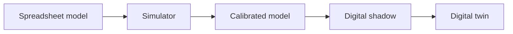
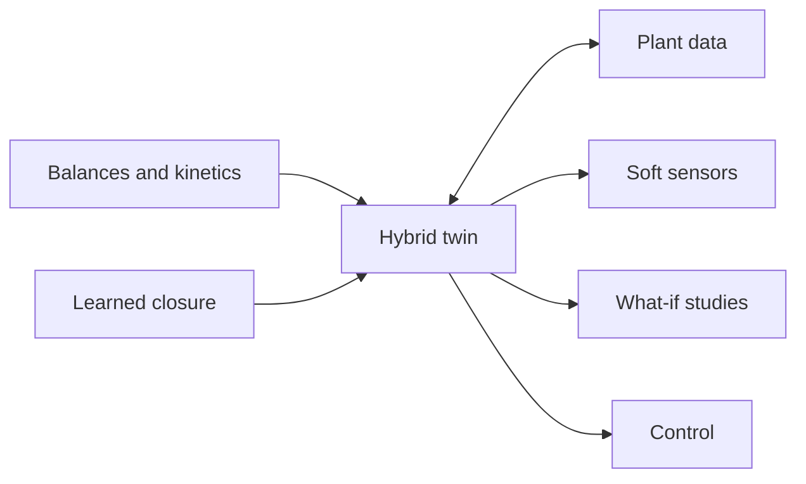

## Why this course

Self-driving cars, drones and robots learn in simulators long before they meet the real world. Process engineering deserves its own virtual world: a place to try a feed strategy, a mixing change or a sensor failure before it costs a batch.

Industry talks about "digital twins" constantly, yet most engineers have never built one. Most so-called twins are either rigid first-principles models that drift away from the plant, or black-box machine learning that breaks outside the data it has seen. The defensible middle is the hybrid twin: balances and kinetics set the bounds, learned parts fill what physics cannot, and live data keeps the whole thing honest. The instructor builds these for a living, and this course shows you how.

A twin is only useful if it is honest about what it does not know.

## Who it is for

#### Undergraduates

Turn material and energy balances into running code, and see why a model that conserves mass is worth more than one that merely fits.

#### Graduate students

Learn a repeatable pattern for calibrating, hybridizing and validating models of your own unit operation or research system.

#### Practicing engineers

Get a working vocabulary and a working prototype: soft sensors, what-if studies and drift alarms for a process you know well.

#### Leaders and managers

Learn to judge vendor "twin" claims, ask the right questions of your team, and know what a trustworthy twin must show.

## What you will be able to do

1. **Tell a model from a twin.** Place any tool on the spectrum and name what data flows in and what decisions flow out.
2. **Turn balances into tested code.** Write mass, energy and species balances with an AI assistant, and prove they conserve.
3. **Calibrate a model to data.** Clean messy sensor series, fit kinetic parameters, and read the residuals.
4. **Build a hybrid model.** Let physics bound a small learned closure for the term you cannot derive.
5. **Quantify uncertainty and detect drift.** Separate fixed, drifting and live parameters, and raise an alarm when the twin stops matching the plant.
6. **Use and deploy a twin.** Run what-if scenarios, design the next experiment, hand off to control, and ship a dashboard.

## Model, shadow, twin

The words are used loosely, so the course uses them precisely: they differ by how data and decisions move between the plant and the model.

| Kind | Data flow | Typical use |
|---|---|---|
| Spreadsheet model or simulator | None. Inputs typed by hand. | Design, sizing, teaching |
| Calibrated model | Historical data fitted once | Scale-up, troubleshooting |
| Digital shadow | Plant to model, one way, live | Monitoring, soft sensors |
| Digital twin | Plant to model and decisions back to plant | What-if, optimization, control |

## Seven weeks, four moves

The course follows one pathway: Play with a working twin, Build your own, Verify that it is honest, then Deploy it.

{{week_grid}}

## The hybrid idea

Mass and energy balances are not negotiable, but rate laws, transfer coefficients and cell behavior often are. The hybrid twin keeps the balances and learns only the uncertain terms.

The learned parts live inside the balances, so they cannot create mass or energy from nothing. That bound is what lets a hybrid twin extrapolate more safely than a black box.

## The capstone

A hybrid digital twin of a fed-batch bioreactor or CSTR that syncs with sensor data, reports what it does not know, runs what-if scenarios, and ships as a dashboard.

Each capstone includes:

- A tested simulation core that conserves mass, with a calibrated, hybrid model on top.
- A validation report with residuals, uncertainty and a drift alarm.
- A deployed dashboard and short documentation another engineer could trust.

## How every week runs

Each week has three one-hour sessions, always in the same order.

#### Concept

One hour on the idea and the process question behind it, with no code on screen.

#### Studio

One hour of guided vibe coding: you describe, the AI assistant writes, and you check it against a balance.

#### Lab

One hour on your own, applying the week to a bioreactor or CSTR dataset and producing the week's deliverable.

## What you need, and what you don't

#### You need

A laptop, a web browser, a free AI assistant account, and a process you care about.

#### You don't need

Prior coding, a command line, Git, any installations, or a plant of your own. Datasets are provided.

## Tools you will meet

Claude
ChatGPT
Gemini
Copilot
Cursor
Google Colab
Python
SciPy
pandas
PyTorch
Streamlit
MQTT
GitHub

## After this course

- Build a first twin of your own unit operation.
- Judge vendor "twin" claims with a clear checklist.
- Hand a trustworthy simulator to an RL or model predictive controller.
- Give AI agents a safe, honest model to reason with.

Continue with [Course 3: Agentic AI for Process Operations]({{root}}agentic-ai/index.html) or [Course 1: Reinforcement Learning for Chemical Engineers]({{root}}rl-vibe-coding/index.html).
