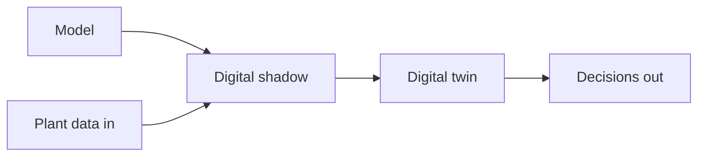

This week sets the vocabulary and the stakes. You will see where a spreadsheet model ends and a twin begins, steer a live bioreactor twin in your browser, and write your first vibe-coded simulation. For an engineer, it matters because every later decision depends on knowing which kind of model you are holding.

## Learning goals

- Place a model, simulator, digital shadow and digital twin on one spectrum.
- Explain what data flows in and what decisions flow out of each.
- Set up an AI workspace and run code in the browser without installing anything.
- Describe a draining tank in plain English and get a working simulation from an assistant.



## Sessions

<div class="session" markdown="1">

### Session 1 · Concept — Models, simulators, twins: the spectrum, and where industry is

We separate hype from practice. A twin is defined by its connection to the plant, not by how detailed its equations are.

**In class**

- The five-step spectrum from spreadsheet to twin
- Where industry actually sits today, and common vendor claims
- Why most twins drift or break, and what a hybrid does about it

**Hands-on:** Sort ten real tools and claims onto the spectrum in small groups.

**You leave with:** A one-page checklist for deciding whether something is a model, a shadow or a twin.

</div>

<div class="session" markdown="1">

### Session 2 · Studio — Play: steer a live bioreactor twin in the browser

You change feed rate, aeration and temperature in a running twin and watch dissolved oxygen, biomass and substrate respond. No code yet, only questions.

**In class**

- Steering a fed-batch run and noticing what the twin gets right
- Finding where the twin looks wrong or overconfident
- Naming the balances you can already see at work

**Hands-on:** Run three scenarios and note one surprise in your build journal.

**You leave with:** A short list of what the twin assumes and what you would test.

</div>

<div class="session" markdown="1">

### Session 3 · Lab — Your AI workspace and a first vibe-coded simulation: a draining tank

You set up an AI assistant and Google Colab, then describe a draining tank and let the assistant write the simulation. You check it against a hand calculation.

**In class**

- Opening Colab and starting your prompt log
- Describing the tank, its outlet and the result you expect
- Comparing the plot with the analytic solution

**Hands-on:** Generate, run and verify a draining-tank simulation.

**You leave with:** A working notebook and a first entry in your prompt log.

</div>

## Prompt of the week

```text
I am a chemical engineer with no coding background.
Write a Python simulation for a cylindrical tank draining
through an orifice at the bottom.

Tank: 1.0 m diameter, initial level 2.0 m.
Outlet: 2 cm diameter, discharge coefficient 0.61.

Plot level versus time until the tank is empty.
Compare with a hand-derived expression for Torricelli flow.
Explain each step in plain English and tell me how I can
check that volume is conserved.
```

## Deliverable

<div class="callout tip" markdown="1">

A draining-tank notebook that matches the analytic answer, plus a one-paragraph note placing a tool from your own field on the model-to-twin spectrum.

</div>
