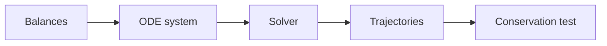

This week turns the balances you already know into running code. You will build a fed-batch model with an AI assistant and, more importantly, write a test that proves it conserves mass. A model that fails that test is not ready to meet data.

## Learning goals

- Write mass, energy and species balances as a set of differential equations.
- Understand, in plain terms, how an ODE solver steps through time.
- Write a conservation test and read its result.
- Ask an assistant to explain every line it generates.



## Sessions

<div class="session" markdown="1">

### Session 1 · Concept — Balances as code: mass, energy, species

We restate accumulation equals in minus out plus generation as something a computer can step through. The same few terms show up in every unit operation.

**In class**

- States, inputs, parameters and rates in a fed-batch vessel
- Species balances for biomass, substrate and product
- Where energy and volume enter, and why feed changes the volume

**Hands-on:** Write the balances for a fed-batch reactor on paper, then in words for the assistant.

**You leave with:** A labelled list of states, inputs and parameters for your capstone unit.

</div>

<div class="session" markdown="1">

### Session 2 · Studio — Kinetics and ODE solvers, explained by your AI assistant

You ask the assistant to explain Monod growth, yield and an ODE solver as if teaching a process engineer. You then have it write the model and challenge its choices.

**In class**

- Monod kinetics, yield coefficients and maintenance
- What a time step is and why stiff systems need a careful solver
- Reading generated code by asking questions, not by knowing syntax

**Hands-on:** Generate a fed-batch model and change one kinetic parameter to see the effect.

**You leave with:** A running model and three questions you can ask any generated code.

</div>

<div class="session" markdown="1">

### Session 3 · Lab — A fed-batch model that conserves mass, with a test that proves it

You add a check that total mass in the vessel equals initial mass plus feed minus withdrawals, at every time point. Then you break the model on purpose and watch the test fail.

**In class**

- Writing the conservation check as a prompt
- Setting a sensible tolerance
- Introducing a bug, such as a dropped feed term, and catching it

**Hands-on:** Build the model, run the test, then break and repair it.

**You leave with:** A fed-batch notebook with a passing conservation test.

</div>

## Prompt of the week

```text
Build a fed-batch bioreactor model in Python.
States: biomass X, substrate S, product P, volume V.
Kinetics: Monod growth with mu_max = 0.4 per hour,
Ks = 0.5 g/L, yield Yxs = 0.5 g/g.
Feed: 0.1 L/h of 200 g/L substrate starting at hour 6.

Solve with SciPy and plot all four states.
Then write a test that checks total substrate mass
(in the vessel, consumed, and fed) balances to within
0.1 percent at every time point.
Explain what the test is doing in plain English.
```

## Deliverable

<div class="callout tip" markdown="1">

A fed-batch notebook with a conservation test that passes, and a second version with a deliberate bug showing the test failing.

</div>
