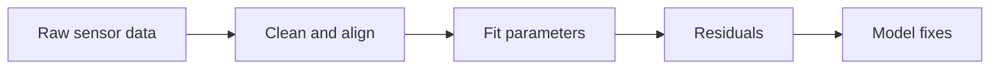

A model that has never met data is a hypothesis. This week you bring in real sensor series, clean them, fit kinetic parameters and learn to read the residuals. The residuals tell you where the physics is missing, and that sets up the hybrid in Week 4.

## Learning goals

- Spot and fix common sensor problems: dropouts, spikes, drift and mismatched sampling.
- Estimate kinetic parameters from batch data with an assistant's help.
- Read residual plots to see what the model gets wrong.
- Separate a bad fit from a bad model.



## Sessions

<div class="session" markdown="1">

### Session 1 · Concept — Sensors and time series: cleaning messy plant data with AI

Plant data is rarely tidy. We look at what DO probes, pH sensors and off-line assays really report, and what goes wrong between the vessel and the file.

**In class**

- Probe lag, calibration drift, noise and missing values
- Aligning fast online signals with slow offline samples
- What to ask an assistant to do, and what to check yourself

**Hands-on:** Inspect a messy bioreactor log and list every problem you can find.

**You leave with:** A cleaning plan written as a prompt.

</div>

<div class="session" markdown="1">

### Session 2 · Studio — Parameter estimation: fitting kinetics to data

You fit growth and yield parameters by least squares and learn why the starting guess, the bounds and the data design all matter.

**In class**

- The objective function: what "fit" means
- Bounds, units and sensible initial guesses
- Why two parameter sets can fit equally well

**Hands-on:** Fit mu_max, Ks and yield to a provided batch dataset.

**You leave with:** Fitted parameters with a note on how confident you are in each.

</div>

<div class="session" markdown="1">

### Session 3 · Lab — Calibrate your model and read the residuals

You overlay the calibrated model on a held-out run and plot residuals against time and against state. Patterns in the residuals point to missing physics.

**In class**

- Calibrating on one run, testing on another
- Residuals versus time, versus DO and versus feed
- Writing a one-paragraph diagnosis

**Hands-on:** Calibrate, validate on a held-out batch and diagnose the misfit.

**You leave with:** A calibrated model and a residual diagnosis you can defend.

</div>

## Prompt of the week

```text
I have a CSV from a fed-batch run with columns:
time_h, DO_percent, pH, OD600, feed_mL_h.

Clean it: remove spikes beyond 5 sigma, fill gaps shorter
than 10 minutes by interpolation, and flag longer gaps.
Align offline OD600 samples with the online signals.

Then fit mu_max, Ks and Yxs of my Monod model to the first
run using least squares with sensible bounds.
Plot the model against the second run and plot residuals
against time. Tell me what patterns I should look for.
```

## Deliverable

<div class="callout tip" markdown="1">

A cleaned dataset, a calibrated model validated on a held-out run, and a short residual diagnosis naming the physics you think is missing.

</div>
