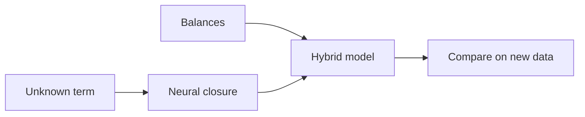

Where physics stops, a small neural network can learn the missing term. The key is where you put it. This week you place the learned part inside the balances, so the model still conserves mass, and compare three approaches head to head.

## Learning goals

- Identify which term in a balance is truly unknown, such as a specific rate or a kLa.
- Build a hybrid model with a physics skeleton and a small learned closure.
- Compare mechanistic, data-only and hybrid models on data they have not seen.
- Explain why bounded learned parts extrapolate more safely.



## Sessions

<div class="session" markdown="1">

### Session 1 · Concept — Where physics stops: learning the unknown term

We go back to the residuals from Week 3 and ask which term in the balance they point to. Often it is oxygen transfer, a growth inhibition or a heat loss.

**In class**

- Closure terms in balances: rates, transfer coefficients, heat losses
- Black-box, gray-box and hybrid models, and their failure modes
- Why constraints matter more than network size

**Hands-on:** Mark the unknown term in your own balance and describe what it depends on.

**You leave with:** A named closure term and the inputs it should see.

</div>

<div class="session" markdown="1">

### Session 2 · Studio — Build a hybrid: physics skeleton, machine-learned closure

With your assistant, you replace one rate expression with a small neural network inside the ODE system. You keep the balances intact and bound the output to physical limits.

**In class**

- A tiny network in PyTorch, explained without jargon
- Training the closure through the ODE solution
- Bounding outputs so rates cannot go negative or exceed limits

**Hands-on:** Build the hybrid and confirm the conservation test still passes.

**You leave with:** A trained hybrid model that conserves mass.

</div>

<div class="session" markdown="1">

### Session 3 · Lab — Mechanistic vs. data-only vs. hybrid, head to head

You score three models on a run outside the training range. You look for the case where each one fails, and write down what that tells you.

**In class**

- A shared scoreboard: error, conservation, and behavior outside the data
- Pushing each model to a new feed or temperature
- Choosing which model you would trust, and why

**Hands-on:** Run the head-to-head and extrapolate each model beyond its data.

**You leave with:** A comparison table and a recommendation in two sentences.

</div>

## Prompt of the week

```text
Take my fed-batch ODE model (attached) and replace the
specific growth rate with a small neural network in PyTorch.

Inputs: substrate S, dissolved oxygen DO, temperature T.
Output: mu, bounded between 0 and 0.6 per hour.

Keep the mass balances for X, S, P and V unchanged so that
mass is conserved by construction.
Train it on my calibration runs, then compare against my
Monod model and a pure neural network on the held-out run.
Show errors and a conservation check for each.
```

## Deliverable

<div class="callout tip" markdown="1">

A hybrid model with a passing conservation test, and a one-page comparison of mechanistic, data-only and hybrid behavior, including outside the training data.

</div>
