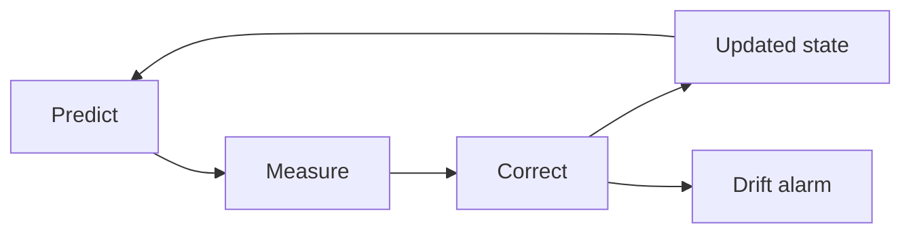

A twin that cannot say what it does not know is a liability. This week you sort parameters into fixed, drifting and live, use a Kalman-style filter to correct the model with each new measurement, and build a validation protocol with a drift alarm.

## Learning goals

- Classify parameters as fixed, drifting or live, and treat each accordingly.
- Explain the predict, measure, correct loop in plain terms.
- Report uncertainty alongside every prediction.
- Design a validation protocol and a drift alarm.



## Sessions

<div class="session" markdown="1">

### Session 1 · Concept — Uncertainty: fixed, drifting and live parameters

Not every number in a model deserves the same trust. A tank volume is fixed, a membrane or probe may drift over weeks, and a growth rate changes within a batch.

**In class**

- Three kinds of parameter and how to update each
- Sources of uncertainty: measurement, parameter and model form
- Showing ranges instead of single lines

**Hands-on:** Classify every parameter in your twin and justify each choice.

**You leave with:** A parameter register with a type and an uncertainty for each entry.

</div>

<div class="session" markdown="1">

### Session 2 · Studio — State estimation and data assimilation: Kalman intuition

We build intuition for a Kalman filter without the matrix algebra. Predict where the state should be, compare with the sensor, then move toward the sensor in proportion to how much you trust it.

**In class**

- The trust balance between model and measurement
- Running a filter on a noisy DO or biomass signal
- Estimating a state you cannot measure directly

**Hands-on:** Add a filter to your twin and tune the model-versus-sensor trust.

**You leave with:** A twin that tracks a noisy signal and estimates a hidden state.

</div>

<div class="session" markdown="1">

### Session 3 · Lab — A validation protocol and a drift alarm

You write the rules the twin must pass before anyone uses it, then add an alarm that fires when residuals show a persistent bias.

**In class**

- Validation rules: conservation, held-out error and residual behavior
- A simple drift test on a rolling window of residuals
- Injecting drift into a dataset to see if the alarm catches it

**Hands-on:** Inject a slow probe drift and tune the alarm.

**You leave with:** A validation checklist and a working drift alarm.

</div>

## Prompt of the week

```text
Add state estimation to my fed-batch twin.
Use an extended Kalman filter, but explain it like I am a
process engineer, not a mathematician.

Measurements: DO every minute, OD600 every hour.
Hidden states to estimate: biomass X and the kLa parameter.

Show the estimate with a 95 percent band.
Then write a drift alarm that flags when the rolling mean of
DO residuals over 30 minutes exceeds 2 percent saturation.
Test it by adding a slow 0.1 percent per hour probe drift.
```

## Deliverable

<div class="callout tip" markdown="1">

A twin that reports a prediction with uncertainty bands, a written validation protocol, and a drift alarm tested on injected drift.

</div>
