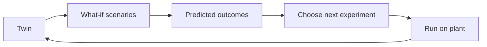

Now the twin starts earning its keep. This week you use it as a soft sensor, ask what-if questions that would be expensive on the real vessel, and let it design your next experiment. You also see where control, including RL and MPC, plugs in.

## Learning goals

- Build a soft sensor for a quantity you cannot measure online.
- Run what-if scenarios and report them with uncertainty.
- Explain how a twin serves as the simulator for RL or MPC.
- Choose the next experiment that tells you the most.



## Sessions

<div class="session" markdown="1">

### Session 1 · Concept — Soft sensors and what-if scenarios

A soft sensor turns cheap measurements and a model into an estimate of something hard to measure. What-if scenarios turn the same model into a safe place to test decisions.

**In class**

- Soft sensors: what they estimate and when to distrust them
- Scenario design: feed profile, temperature shift and sensor failure
- Reporting ranges, not just a single prediction

**Hands-on:** List three expensive questions in your own process that a twin could answer.

**You leave with:** A scenario list ranked by value and risk.

</div>

<div class="session" markdown="1">

### Session 2 · Studio — Optimization and control on the twin: the hand-off to RL and MPC

We use the twin as a simulator for a controller. You try a simple feed optimizer, then see how an RL agent or a model predictive controller would use the same twin.

**In class**

- Optimizing a feed profile for yield on the twin
- Why a trusted simulator is the prerequisite for RL
- MPC as the twin used in a loop, one step ahead

**Hands-on:** Optimize a feed profile and note where it relies on parts the twin knows least.

**You leave with:** An optimized feed profile and a list of its risks.

</div>

<div class="session" markdown="1">

### Session 3 · Lab — Design the next experiment with the twin

You use the twin's uncertainty to find the experiment that would shrink it most, and write the run sheet a lab technician could follow.

**In class**

- Where parameter uncertainty is largest and why
- Simulating candidate experiments and ranking them
- Turning the winner into a run sheet

**Hands-on:** Rank three candidate experiments by expected information gain.

**You leave with:** A run sheet for the experiment you would do next.

</div>

## Prompt of the week

```text
Using my calibrated hybrid twin, build a soft sensor for
biomass concentration from DO, pH, feed rate and off-gas.

Then run these what-if scenarios and plot each with an
uncertainty band:
1. Feed rate 20 percent higher from hour 8.
2. Aeration cut by 30 percent at hour 10.
3. DO probe fails at hour 12 and reads a constant value.

For each, tell me the final titer and the risk of oxygen
limitation. Say which prediction you are least sure of.
```

## Deliverable

<div class="callout tip" markdown="1">

A soft sensor, three what-if scenarios with uncertainty, and a run sheet for the experiment the twin recommends next.

</div>
