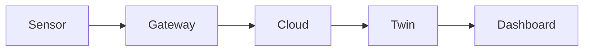

A twin on your laptop helps you. A twin others can open, trust and maintain helps your organization. This week covers the path from sensor to cloud to dashboard, packages your twin as an app, and ends with the capstone showcase.

## Learning goals

- Describe how data travels from a device to the cloud to a twin.
- Package a twin as a simple web app with a dashboard.
- Document assumptions, limits and ownership so others can trust the twin.
- Present a capstone and defend its validation.



## Sessions

<div class="session" markdown="1">

### Session 1 · Concept — Device to cloud: data pipelines and dashboards, conceptually

We follow a DO reading from the probe to a screen, and name every place it can go wrong. No cloud accounts are needed; the focus is the architecture.

**In class**

- Sensors, gateways, message brokers such as MQTT, storage and compute
- Latency, security and what happens when the network drops
- How a twin consumes data and publishes results

**Hands-on:** Draw the pipeline for your capstone unit and mark its failure points.

**You leave with:** An architecture sketch you could hand to an IT team.

</div>

<div class="session" markdown="1">

### Session 2 · Studio — Package the twin as an app; document and govern it

You turn your notebook into a small dashboard app, with a gentle first look at GitHub for saving and sharing it. Then you write the model card that goes with it.

**In class**

- A Streamlit dashboard with inputs, predictions and uncertainty
- A first, gentle look at GitHub for sharing the project
- A model card: purpose, data, limits, owner and review date

**Hands-on:** Build the dashboard and write its model card.

**You leave with:** A shareable app and documentation another engineer could trust.

</div>

<div class="session" markdown="1">

### Session 3 · Capstone showcase

Each participant presents a hybrid twin of a fed-batch bioreactor or CSTR. You show the dashboard, the validation evidence and what the twin says it does not know.

**In class**

- Five-minute demos with a live what-if
- Questions on validation, drift and uncertainty
- Peer feedback against the rubric

**Hands-on:** Present your twin and answer questions from peers.

**You leave with:** A finished capstone, feedback, and a plan for your own first twin.

</div>

## Prompt of the week

```text
Turn my hybrid twin notebook into a Streamlit app.

Inputs: feed rate, aeration, temperature.
Outputs: predicted biomass, substrate and DO over time,
shown with a 95 percent uncertainty band.
Add a panel that shows the latest drift alarm status and
the date of the last validation.

Then draft a one-page model card with: purpose, data used,
parameter register, known limits, owner and review date.
Keep the language plain enough for a plant manager.
```

## Deliverable

<div class="callout tip" markdown="1">

The capstone: a hybrid twin with a validation report, a deployed dashboard and a model card, presented live.

</div>
