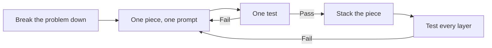

## Why this course

Reinforcement learning fits chemical engineering. Fed-batch feeding, process control and scheduling are all sequential decisions with delayed rewards and dynamic states. Yet RL rarely appears in ChemE curricula. The barrier was never the idea. It was the software: Python, Gymnasium, Stable-Baselines3, and the weeks it took to wire them together.

That wall is gone. With an AI coding assistant, an engineer can describe a process in plain English and co-write a working simulator and environment. The instructor lived the old barrier in 2019, building the Game of Cells cell-culture twin by hand, and later published RL control for CAR T-cell expansion and fed-batch enzyme production. This course compresses that path into seven weeks.

If AI is replacing software engineers, who designs and deploys the systems? Process engineers do.

## Who it is for

#### Undergraduates

Juniors and seniors who know material balances and want a modern tool for control and optimization, with no coding background required.

#### Graduate students

Researchers who want to prototype RL for their own unit operation and read process-control RL papers with a critical eye.

#### Practicing engineers

Process, automation and bioprocess engineers who want a working, tested controller prototype without a software team.

#### Leaders and managers

Technical leaders who need to judge what AI can and cannot do on a plant, and ask the right verification questions.

## What you will be able to do

1. **Explain RL in ChemE terms.** State, action, reward and policy, mapped onto a reactor.
2. **Decide if a problem is an RL problem.** Apply a process engineer's checklist before writing a line of code.
3. **Write a spec sheet an AI can build from.** Define state, action and reward precisely enough to test.
4. **Co-author and test a simulator and environment.** Mass balances and Monod kinetics become a Gymnasium environment.
5. **Train, benchmark and diagnose an agent.** Compare against an operator's recipe and catch reward hacking.
6. **Ship a documented app.** Hand off a controller dashboard that others can open and use.

## From a snake to a bioreactor

The course starts with a game everyone knows, then swaps the board for a reactor.

| Snake game | Fed-batch bioreactor | RL term |
|---|---|---|
| Board | Reactor | Environment |
| Snake position, food location | Biomass, substrate, product, volume, DO | State |
| Up, down, left, right | Feed pump rate (0 to 50 mL) | Action |
| Eat food, +1 | Enzyme titer | Reward |
| Hit the wall | Overflow, substrate inhibition, oxygen limit | Constraint violation |
| Game over | Batch end | Episode end |

*A fed-batch RL setup: external substrate tank, feed pump, sample outlet, sensor readings of enzyme activity and cell concentration, and the RL algorithm closing the loop.*

## Seven weeks, four moves

Every week belongs to one of four moves: Play with the idea, Build the pieces, Verify before you trust, and Deploy what you made.

{{week_grid}}

## The vibe-coding method

One lesson, repeated until it is a habit. Never ask the AI for the whole system. Ask for one piece, test that piece, then stack it.

A failed test is not a setback. It is the loop working: you refine the prompt, not the code. The tests are mass balances, sanity bounds and benchmarks that any process engineer already trusts.

## The capstone

An RL feeding controller for a fed-batch bioreactor twin, benchmarked against an operator's recipe, stress-tested with a faulty pump, and shipped as a shareable web app.

- **A tested twin and environment.** A fed-batch simulator wrapped as a Gymnasium environment, with its test suite.
- **A trained and benchmarked controller.** Titer compared against the recipe, plus a faulty-pump stress test.
- **A shareable app and build journal.** A controller dashboard and a prompt log that documents how it was built.

## How every week runs

#### Concept

One hour. The idea in plain words, with ChemE analogies and live demonstrations.

#### Studio

One hour. Work through a design problem together: specs, prompts and reward choices with an AI assistant.

#### Lab

One hour. Hands-on build in the browser, with a test for every piece you make.

## What you need, and what you don't

#### You need

A laptop, a web browser, a free AI assistant account, and a process you care about.

#### You don't need

Prior coding, a command line, Git, or any software installation. Code runs in the browser.

## Tools you will meet

Claude
ChatGPT
Gemini
Copilot
Google Colab
Python
Gymnasium
Stable-Baselines3
Streamlit
GitHub

## After this course

- Read and question RL papers in process control.
- Prototype RL for your own unit operation.
- Work fluently with any AI coding assistant.
- Judge AI-built tools by the tests they pass, not the confidence they project.

Next: [Course 2: Digital Twins for Process Engineering]({{root}}digital-twins/index.html) builds a better world to train in.
