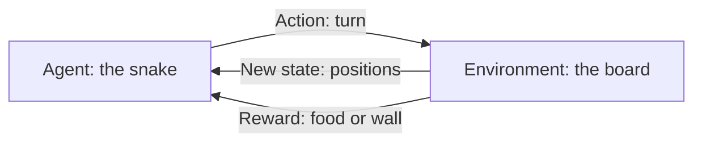

This week you play before you calculate. A snake game teaches the four words that run the whole course: state, action, reward and policy. You also meet your AI workspace, because for the next seven weeks it is your pair-programmer.

For an engineer, the payoff is vocabulary. Once you can name the loop in a game, you can find it in a reactor.

## Learning goals

- Explain how AI changes who can build engineering software.
- Define state, action, reward and policy using a game you have played.
- Hold a first productive conversation with an AI coding assistant.
- Describe a learning agent as a loop, not a formula.



## Sessions

<div class="session" markdown="1">

### Session 1 · Concept — Who writes the code now? AI as an engineering tool

AI assistants now write most routine code, which shifts the scarce skill from typing syntax to specifying and verifying. That is the process engineer's home ground.

**In class**

- What AI coding assistants do well, and where they fail quietly
- Why a clear specification beats programming skill
- A live demo: a plain-English request becomes a running program

**Hands-on:** Ask an assistant to explain one unit operation you know, then critique its answer.

**You leave with:** A realistic sense of what the AI can and cannot be trusted to do.

</div>

<div class="session" markdown="1">

### Session 2 · Studio — Meet the snake: state, action, reward, policy

You play the snake game by hand, then describe your own strategy in words. That description is a policy, and the score is the reward.

**In class**

- Play rounds and write down what you looked at before each move
- Name the state, the actions and the reward in your own words
- Compare a random policy, a greedy policy and your own

**Hands-on:** Play five rounds, then write your strategy as three plain rules.

**You leave with:** A one-page glossary of the four RL terms, in your own words.

</div>

<div class="session" markdown="1">

### Session 3 · Lab — Your AI workspace: first conversation with a coding assistant

You set up a free assistant and a Colab notebook, then run your first piece of AI-written code. Nothing is installed on your machine.

**In class**

- Open Google Colab and connect an assistant account
- Ask the assistant to explain a short snippet line by line
- Start a prompt log that you will keep all seven weeks

**Hands-on:** Run one AI-written cell and explain what it printed.

**You leave with:** A working workspace and the first entries in your prompt log.

</div>

## Prompt of the week

```text
I am a chemical engineer with no coding background.
Explain reinforcement learning using the snake game.
Use these four words and define each in one sentence:
state, action, reward, policy.
Then show me where each one would appear if the
"snake" were a feed pump on a fed-batch bioreactor.
Keep it under 200 words and avoid jargon.
```

## Deliverable

<div class="callout tip" markdown="1">

**Snake notes and prompt log.** A one-page description of your snake strategy using state, action, reward and policy, plus your first prompt-log entries.

</div>
