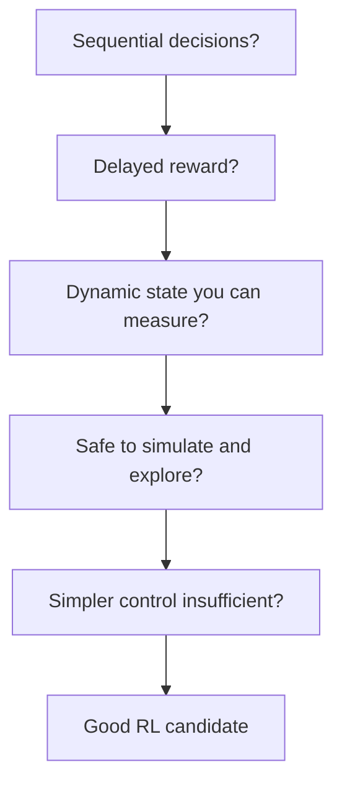

This week the same loop moves from a board to a fed-batch culture. You feed a simulated bioreactor by hand and feel how hard it is to balance growth against overflow and oxygen limits.

For an engineer the key skill is judgment: which process problems are genuinely RL problems, and which are better served by a PID loop or a recipe.

## Learning goals

- Map a fed-batch process onto state, action and reward.
- Apply a checklist to decide whether a problem suits RL.
- Define episode, return and exploration in plain words.
- Recognize delayed reward in a fermentation.



## Sessions

<div class="session" markdown="1">

### Session 1 · Concept — The bioreactor game: feeding a culture by hand

You take the pump controls of a simulated fed-batch culture. Feed too little and growth stalls. Feed too much and substrate inhibition or an oxygen limit ends the batch.

**In class**

- Read the state: biomass, substrate, product, volume and dissolved oxygen
- Choose a feed rate from 0 to 50 mL each step
- Compare your titer with the operator's recipe

**Hands-on:** Run three batches by hand and record your titer for each.

**You leave with:** A felt sense of why feeding is a sequential decision problem.

</div>

<div class="session" markdown="1">

### Session 2 · Studio — Is your problem an RL problem? The process engineer's checklist

You test candidate problems against a checklist: sequential decisions, delayed reward, measurable state, safe exploration, and whether simpler control already works.

**In class**

- Score fed-batch feeding, a heat exchanger and a batch schedule against the checklist
- Debate where RL adds value and where PID is enough
- Bring one process of your own and score it

**Hands-on:** Fill out the checklist for a process from your own work.

**You leave with:** A scored checklist and an honest first answer on your candidate problem.

</div>

<div class="session" markdown="1">

### Session 3 · Lab — Episodes, returns, exploration: the learning loop in plain words

You watch a simple agent learn over many episodes and read how its return improves. Exploration is the agent trying feed rates it has not tried before.

**In class**

- Define an episode as one batch from inoculation to harvest
- Read a return curve and explain why early batches look bad
- Change the exploration level and observe the effect

**Hands-on:** Run a toy learner and plot return against episode number.

**You leave with:** A plain-language explanation of how an agent improves with experience.

</div>

## Prompt of the week

```text
Act as a bioprocess engineer teaching a new colleague.
Describe a fed-batch fermentation as a reinforcement
learning problem.
State: biomass, substrate, product, volume, dissolved oxygen.
Action: feed pump rate between 0 and 50 mL per step.
Reward: final enzyme titer.
Explain what an episode is here, why the reward is delayed,
and what exploration would mean for a real reactor.
Then list two reasons this problem might not suit RL.
```

## Deliverable

<div class="callout tip" markdown="1">

**RL-fit memo.** A one-page checklist score for a process of your choice, with a clear verdict on whether it is an RL problem and why.

</div>
