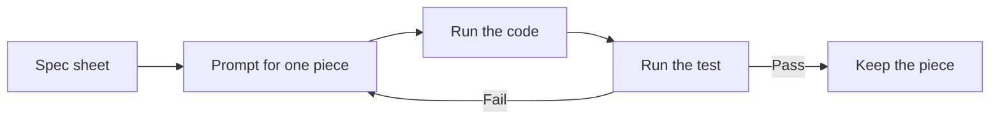

This is the core habit of the course. You stop asking an AI for a whole program and start asking for one piece at a time, each with its own test.

For an engineer this is familiar. It is how you commission a plant: unit by unit, with checks at every stage before the system runs together.

## Learning goals

- Describe what vibe coding is and what it is not.
- Break a process problem into small, testable pieces.
- Write a spec sheet for state, action and reward.
- Pair every prompt with a test that can fail.



## Sessions

<div class="session" markdown="1">

### Session 1 · Concept — What vibe coding is, and what it is not

Vibe coding means directing an AI in plain language and judging the result by tests. It does not mean accepting whatever runs.

**In class**

- Good and bad examples: a vague prompt versus a specified one
- Why untested AI code fails silently, with a live example
- The one-piece, one-prompt, one-test rule

**Hands-on:** Rewrite a vague prompt into a specified one and compare the outputs.

**You leave with:** A short rule set for directing an AI without losing control.

</div>

<div class="session" markdown="1">

### Session 2 · Studio — Break the problem into pieces: spec sheets for state, action, reward

You write spec sheets that list every variable, unit, range and expected behavior. A good spec is something an AI can build from and you can test against.

**In class**

- Draft a spec sheet for the fed-batch state, with units and bounds
- Define the action space and what a legal feed rate means
- Sketch a first reward and name its weaknesses

**Hands-on:** Complete a spec sheet for state, action and reward.

**You leave with:** A reviewed spec sheet that becomes next week's build instructions.

</div>

<div class="session" markdown="1">

### Session 3 · Lab — One piece, one prompt, one test

You build the smallest useful piece, a single unit-converting or rate function, and write a test that can catch it being wrong.

**In class**

- Prompt for one function from your spec sheet
- Write a test with a known answer from hand calculation
- Break the function on purpose and watch the test fail

**Hands-on:** Build and test one function from your spec sheet.

**You leave with:** One tested function and a prompt log entry showing the loop.

</div>

## Prompt of the week

```text
I am building a fed-batch bioreactor simulator in Python.
Write ONE function only: monod_growth_rate(S, mu_max, Ks).
S is substrate concentration in g/L.
mu_max is 0.4 per hour and Ks is 0.5 g/L.
Return the specific growth rate in 1/h.
Add a docstring with units.
Then write three pytest-style checks:
zero substrate gives zero growth,
very high substrate approaches mu_max,
and S equal to Ks gives half of mu_max.
```

## Deliverable

<div class="callout tip" markdown="1">

**Spec sheet and first tested piece.** A completed spec sheet for state, action and reward, plus one AI-written function that passes a test you designed.

</div>
