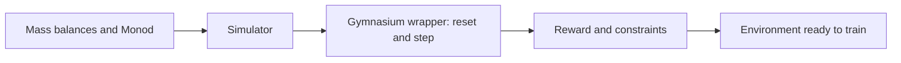

This week the spec sheet becomes working code. You turn mass balances and Monod kinetics into a fed-batch simulator, then wrap it in the standard interface RL libraries expect.

For an engineer this is a model you already know how to write on paper. The new part is making it a reliable environment with a reward that measures what you actually want.

## Learning goals

- Express fed-batch mass balances as a simulator with AI help.
- Wrap a simulator as a Gymnasium environment.
- Check the simulator against hand calculations and balance closure.
- Design a reward that balances titer, constraints and penalties.



## Sessions

<div class="session" markdown="1">

### Session 1 · Concept — Mass balances as code: a fed-batch simulator with AI

Biomass, substrate, product and volume each have a balance, and the feed enters through the volume term. You assemble them piece by piece, testing each against a hand calculation.

**In class**

- Write the four balances in words before any code
- Prompt for each rate and balance as a separate, tested piece
- Check that total mass closes within tolerance

**Hands-on:** Build the simulator and reproduce a hand-calculated batch.

**You leave with:** A tested fed-batch simulator that runs a full batch.

</div>

<div class="session" markdown="1">

### Session 2 · Studio — Wrap it as a Gymnasium environment

An RL library needs a standard interface: reset to start a batch and step to apply one feed action. You specify that wrapper and the AI builds it.

**In class**

- Define observation and action spaces from your spec sheet
- Prompt for reset and step, with termination rules
- Run random actions and confirm the environment never crashes

**Hands-on:** Run 50 random-action batches and check each ends cleanly.

**You leave with:** A working Gymnasium environment for the bioreactor.

</div>

<div class="session" markdown="1">

### Session 3 · Lab — Reward design studio: titer, constraints, penalties

You write a reward that pays for enzyme titer and penalizes overflow, substrate inhibition and low oxygen. Small changes in the reward change the controller you get.

**In class**

- Start with final titer as the only reward and predict how it could go wrong
- Add penalties for constraint violations and compare behavior
- Document every reward term and its units

**Hands-on:** Implement two reward versions and compare them on the same batch.

**You leave with:** A documented reward function and a list of its known weaknesses.

</div>

## Prompt of the week

```text
Write a Gymnasium environment class FedBatchEnv in Python.
It wraps my existing function simulate_step(state, feed_ml).
Observation: biomass, substrate, product, volume, DO.
Action: one continuous value from 0 to 50 mL per step.
reset() starts a batch with these initial conditions: [list].
step() returns observation, reward, terminated, truncated, info.
Terminate if volume exceeds 2 L or DO drops below 20 percent.
Reward: change in product mass, minus 5 if a limit is hit.
Do not change simulate_step. Add comments with units.
```

## Deliverable

<div class="callout tip" markdown="1">

**Tested environment.** A fed-batch Gymnasium environment with a balance-closure test, a random-action run and a one-page reward document.

</div>
