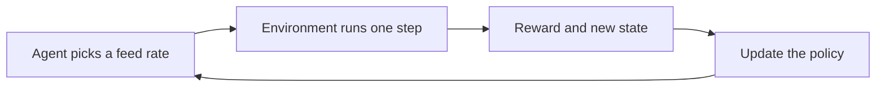

This week the agent learns. You meet the main algorithms in plain language, run a first training session, and read the learning curves.

For an engineer the most valuable skill is skepticism. An agent that scores well is not necessarily doing what you intended, and you learn to find out why.

## Learning goals

- Explain Q-learning, PPO and SAC without equations.
- Launch a training run and read a learning curve.
- Recognize signs that an agent is exploiting the reward.
- Use the AI to diagnose and propose fixes, then verify them.



## Sessions

<div class="session" markdown="1">

### Session 1 · Concept — Algorithms in plain language: Q-learning, PPO, SAC

Each algorithm is a different answer to one question: how should the agent change its policy after seeing what happened. We keep the explanation to analogies and diagrams.

**In class**

- Q-learning as a lookup table of how good each action is
- PPO as careful, small policy updates
- SAC as learning while keeping a deliberate amount of randomness

**Hands-on:** Match each algorithm to a process scenario and justify the choice.

**You leave with:** A one-page guide for choosing an algorithm for a continuous feed action.

</div>

<div class="session" markdown="1">

### Session 2 · Studio — First training run with Stable-Baselines3

You prompt the AI to train an agent on your environment, start with a small run, and learn what each logged number means.

**In class**

- Prompt for a short PPO training run with a fixed random seed
- Read reward per episode, episode length and loss
- Compare the trained agent with random feeding

**Hands-on:** Train for a small budget and plot the learning curve.

**You leave with:** A first trained agent and an annotated learning curve.

</div>

<div class="session" markdown="1">

### Session 3 · Lab — When the agent cheats: debugging rewards with AI

Agents find loopholes. Yours may end batches early to dodge penalties or drive the pump to a boundary. You find the loophole, name it and close it.

**In class**

- Watch the agent's feed trajectory, not only its score
- Spot a reward hack and trace it to a reward term
- Fix the reward, retrain and confirm the behavior changes

**Hands-on:** Find one loophole in your agent and patch the reward.

**You leave with:** A patched reward and a short note on what the agent exploited.

</div>

## Prompt of the week

```text
Using Stable-Baselines3, train a PPO agent on my FedBatchEnv.
Use a fixed seed of 42 and 50,000 timesteps for a first run.
Log episode reward and save the model to a file.
After training, run 20 test batches and plot the feed rate
over time for the best and the worst batch.
Add comments explaining each hyperparameter in plain words.
Do not change the environment code.
```

## Deliverable

<div class="callout tip" markdown="1">

**Training report.** A learning curve, the feed trajectory of your trained agent, and a short note describing one reward loophole you found and fixed.

</div>
