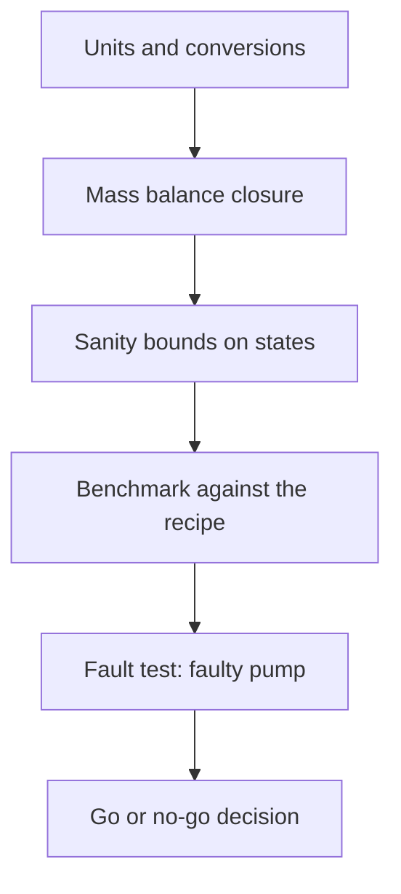

This week you decide whether to trust the controller. You climb a test ladder from unit checks to full closed-loop runs, compare the agent with an operator's recipe, and stress it with a faulty pump.

For an engineer this is the week that matters most. A controller that has not been verified is a hypothesis, however good the training curve looks.

## Learning goals

- Build a test ladder from unit tests to closed-loop benchmarks.
- Benchmark an agent fairly against a fixed recipe.
- Stress test with a fault and report the degradation.
- Say when not to use RL, and why.



## Sessions

<div class="session" markdown="1">

### Session 1 · Concept — The test ladder: units, balances, sanity bounds

Each rung checks something the next rung relies on. Units first, then balance closure, then physical bounds, so a failure points to its cause.

**In class**

- Why a high reward can hide a broken simulator
- Writing balance-closure and non-negativity checks
- Asking the AI to generate tests, then reviewing them critically

**Hands-on:** Add five tests to your environment and run them all.

**You leave with:** A test suite that runs in one click.

</div>

<div class="session" markdown="1">

### Session 2 · Studio — Benchmark against the recipe; stress test with a faulty pump

You compare agent and recipe over many seeded batches, then degrade the pump with a delay or a stuck valve and measure what happens to titer.

**In class**

- Define a fair benchmark: same seeds, same initial conditions
- Report mean titer and spread, not a single best batch
- Inject a pump fault and compare agent and recipe

**Hands-on:** Run the benchmark and the faulty-pump test, then tabulate the results.

**You leave with:** A benchmark table with a fault scenario.

</div>

<div class="session" markdown="1">

### Session 3 · Lab — Safety, constraints, and when not to use RL

Some problems should not be handed to a learned policy. You write down the conditions under which you would not deploy your controller.

**In class**

- Hard constraints versus soft penalties
- Operator override, fallback recipes and safe action limits
- Cases where PID, MPC or a recipe is the better answer

**Hands-on:** Write a one-page deployment safety note for your controller.

**You leave with:** A written go or no-go criterion for your controller.

</div>

## Prompt of the week

```text
I have a trained PPO agent and a fixed operator recipe
for my FedBatchEnv.
Write a benchmark script that runs both over 50 seeded batches
with identical initial conditions.
Report mean and standard deviation of final titer for each.
Then add a fault scenario: the feed pump delivers only
70 percent of the commanded volume after hour 12.
Run both again and print a table: nominal versus faulty,
agent versus recipe.
Flag any batch where a safety limit was violated.
```

## Deliverable

<div class="callout tip" markdown="1">

**Verification report.** A benchmark table of agent versus recipe, nominal and faulty pump, plus a go or no-go statement with your reasoning.

</div>
