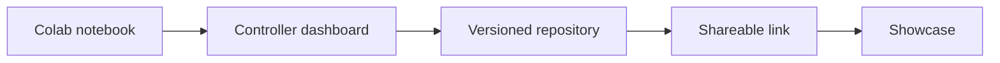

This week you turn a notebook into something other people can use. You build a controller dashboard, take a gentle first look at version control through the browser, and present your capstone.

For an engineer this is the handoff. A result that only lives in your notebook cannot be reviewed, reused or trusted by anyone else.

## Learning goals

- Turn a notebook into a simple interactive app.
- Document a project so a colleague can reproduce it.
- Understand versioning as a record of changes, using the browser only.
- Present results, limits and next steps honestly.



## Sessions

<div class="session" markdown="1">

### Session 1 · Concept — From notebook to app: a controller dashboard

A dashboard lets a colleague set initial conditions and see the feed profile and predicted titer without touching code.

**In class**

- What an app adds beyond a notebook
- Choosing inputs, outputs and plots for an operator audience
- Prompting an AI to build the dashboard in small steps

**Hands-on:** Build a dashboard with two inputs and two plots.

**You leave with:** A working controller dashboard.

</div>

<div class="session" markdown="1">

### Session 2 · Studio — Version, document, hand off (Git through the browser)

Version control is a lab notebook that never loses a page. You use it through the browser, with no command line.

**In class**

- Create a repository and upload your project in the browser
- Write a README that states purpose, inputs, tests and limits
- Record a change with a clear message

**Hands-on:** Publish your project and write its README.

**You leave with:** A documented, versioned project that someone else can open.

</div>

<div class="session" markdown="1">

### Session 3 · Lab — Capstone showcase and what comes next

Each learner presents the controller, its benchmark, its stress test and its limits. Honest limits are part of the grade.

**In class**

- A five-minute demo of the app and the benchmark table
- Questions from peers on verification and safety
- Next steps, including how digital twins improve the training world

**Hands-on:** Present and answer questions on your capstone.

**You leave with:** A finished capstone and a plan for your own process.

</div>

## Prompt of the week

```text
Turn my notebook into a Streamlit app.
Inputs: initial substrate concentration (g/L),
initial volume (L) and a toggle for faulty pump.
Load my trained model file and my FedBatchEnv.
Show two plots: feed rate over time and
biomass, substrate and product over time.
Display the final titer next to the operator recipe's titer.
Add a short note on the page stating the model's limits.
Keep the code in one file with comments.
```

## Deliverable

<div class="callout tip" markdown="1">

**Capstone package.** A shareable controller dashboard, a README with the benchmark and stress-test results, your prompt log, and a live showcase presentation.

</div>
